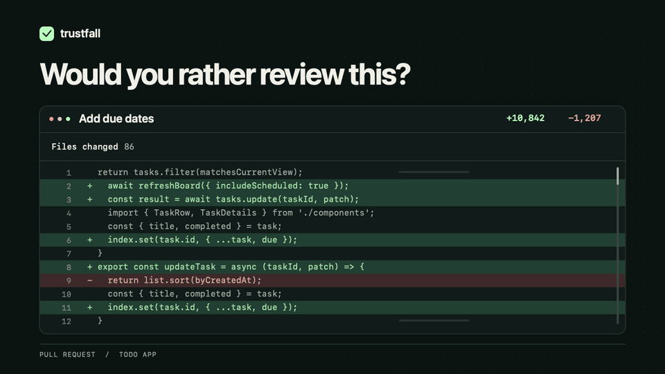

# Trustfall

> Agent skills that build trust in code by designing it on six reviewable Levels



Code is the hardest thing to review. Trustfall describes a project on six
Levels — Concepts, User stories, Architecture, Module trees, Commits and Code —
and designs each Level only from the Levels above it. Every Level is small and
validated against the Levels above by fresh agents with no history of the work.
Before any Code is written, the Commits of a change are planned as the perfect
story of how it would be built in a perfect world. When you trust the upper
Levels, you can trust what follows from them, whether the code was written by an agent or a teammate.

## Installing / Getting started

Install the skills into your project with the cross-agent installer:

```shell
npx skills add jehna/trustfall
```

Then ask your agent to start Trustfall:

```text
Let's design this project with Trustfall.
```

The agent loads the `trustfall` skill, asks you about the project, and starts
the Descent from the first Level, Concepts. Each Level is written to a
`trustfall/` folder in your project.

To understand Trustfall, read how it is designed with itself, in
[`trustfall/`](trustfall/):

1. [Concepts](trustfall/1-concepts.md)
2. [User stories](trustfall/2-stories.md)
3. [Architecture](trustfall/3-architecture.md)
4. [Module trees](trustfall/4-module-trees.md)
5. [Truths](trustfall/truths.md)

### Initial Configuration

Without the installer, copy or symlink the folders in `skills/` to your agent's
skills folder:

| Agent                               | Project folder    |
| ----------------------------------- | ----------------- |
| Claude Code                         | `.claude/skills/` |
| Codex, Antigravity, Pi and OpenCode | `.agents/skills/` |

## Developing

Trustfall is designed with Trustfall. Its own Levels are in `trustfall/` and the
skills in `skills/`. The skills are linked as project skills for every agent, in
`.claude/skills/` and `.agents/skills/`, so working on Trustfall uses the
current skills.

```shell
git clone https://github.com/jehna/trustfall.git
cd trustfall/
npm install
```

`npm install` installs the Markdown linter and formatter and a Husky pre-commit
hook that formats and lints every staged Markdown file.

### Building

There is nothing to build; the skills are plain Markdown. Format and check them
with:

```shell
npm run format
npm run check
```

`format` rewrites every Markdown file with Prettier, and `check` fails if any
file is unformatted or breaks a markdownlint rule.

### Deploying / Publishing

Push to the default branch; the installer reads the skills straight from the
repository.

## Features

- Six Levels, each designed only from the Levels above it
- Commits planned as the perfect story of a change before any Code
- One skill per Level, loaded one at a time
- Validation by subagents with no history of the work
- Commandments that hold in every project, kept apart from its Truths
- Works with Claude Code, Codex, Antigravity, Pi and OpenCode

## Configuration

Each project configures Trustfall through its Truths in
`trustfall/truths.md`. The agent asks for them before planning Commits.

### Truth

Type: `Markdown list item`  
Default: none

A statement that must hold true of the project: how it is built or what it is.
It only affects Commits and Code.

Example:

```markdown
- T1: Every User story is covered by a browser test.
  Verify: for each story ID there is a browser test that names it, and the tests pass.
```

## Contributing

If you'd like to contribute, please fork the repository and use a feature
branch. Pull requests are warmly welcome. Change the highest Level your change
touches first, and Descend from there.

## Links

- Repository: <https://github.com/jehna/trustfall/>
- Issue tracker: <https://github.com/jehna/trustfall/issues>
- Agent Skills installer: <https://github.com/vercel-labs/skills>

## Licensing

The code in this project is licensed under the [MIT license](LICENSE).
