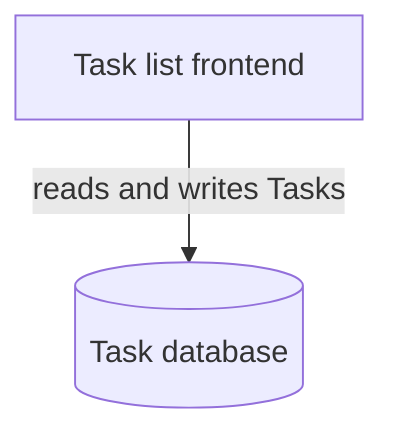

# Architecture

## Architecture purpose

The Architecture shows the concrete building blocks of the project and how they
connect, so you can validate that the project has the right building blocks for
solving the problem.

## Architecture format

`trustfall/3-architecture.md` contains only self-contained Mermaid diagrams;
no other text is needed to understand them.

````markdown
# Architecture


````

- Every node is a Block: a named instance of a technology, e.g. `Task database`
  for a PostgreSQL database. The project builds on the technology but does not
  implement it. Stores use the cylinder shape `[( )]`.
- Every edge is labelled with what flows, in the words of the Concepts.
- When one edge fans out to or gathers from several Blocks, route it through a
  junction node, `j@{ shape: f-circ }`, so it is drawn once.
- Every User story must be possible with the drawn Blocks and edges. Decisions
  a person or agent makes without any technology get no Block or edge.
- Draw nothing inside a Block; that belongs to Module trees.
